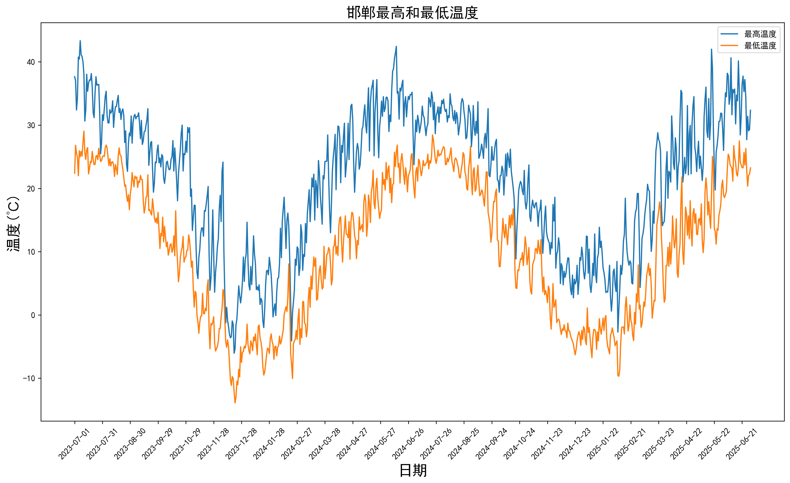
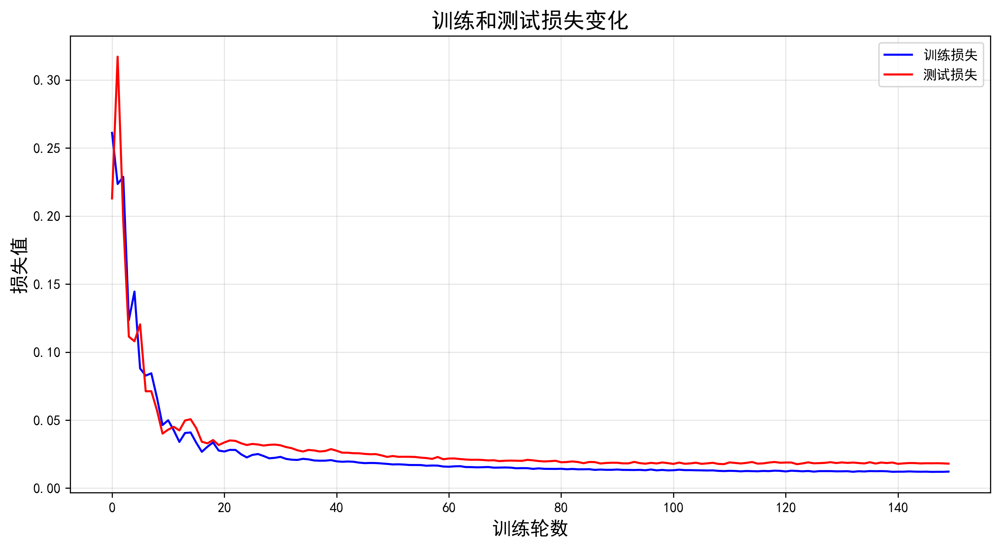
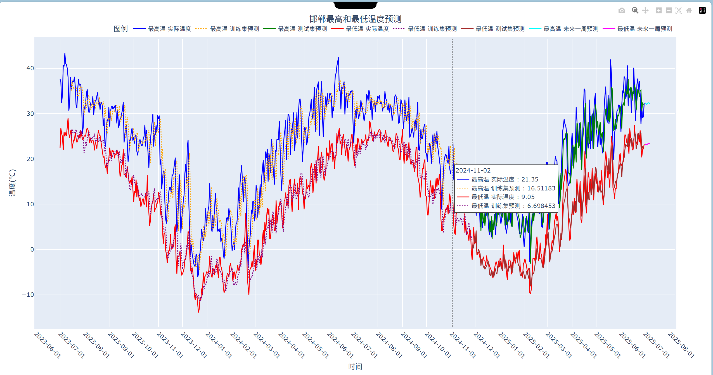

# 🌤️ 基于 LSTM 的邯郸市气温时间序列预测系统

## 📌 项目简介
本项目利用深度学习中的长短期记忆网络（LSTM），对邯郸市 2023 年至 2025 年的历史气象数据进行建模。系统完成了从**原始数据清洗、特征构建、模型训练调优**到**未来7天多步预测**及**交互式可视化**的完整闭环。

## 🛠️ 技术栈
*   **核心语言**：Python
*   **深度学习框架**：PyTorch
*   **数据处理与特征工程**：Pandas, NumPy, Scikit-learn (MinMaxScaler)
*   **可视化图表**：Matplotlib, Plotly (交互式图表)

## 📂 目录结构
```text
├── data_preprocess.py      # 数据清洗与格式转换脚本
├── train.py                # LSTM模型定义、训练、评估与预测主程序
├── handan.csv              # 邯郸气象原始数据集（2023-2025）
├── weather.txt             # 原始文本数据
├── web.png                 # 预测系统可视化界面截图
├── 温度数据可视化.png       # 历史温度数据折线图
└── 训练和测试损失.png       # 损失函数收敛曲线
```

## 🚀 核心实现亮点
数据工程与清洗：利用正则表达式（Regex）清洗带单位（℃、小时）的脏数据；针对时间序列特性，构建 Lookback = 14 的滑动窗口以捕捉长期依赖；通过 MinMaxScaler(-1, 1) 归一化加速模型收敛。
深度网络构建：基于 PyTorch 搭建 3 层 LSTM 网络（隐藏层维度 128），引入 Dropout（0.1）有效防止过拟合，实现对最高温与最低温的双特征联合预测。
多步预测优化（抗误差累积）：在推理未来 7 天温度时，采用自回归模式。为了减缓长期预测导致的误差放大，算法内部执行 10 次独立推理并取均值（简易 Ensemble），大幅提升了趋势预测的稳定性。
高颜值可视化：借助 Plotly 构建交互式折线图（Hover 查看详情），直观对比历史真实温度与训练集/测试集的拟合曲线，并动态展示未来一周的预测轨迹。

## 📊 运行效果展示
### 1. 历史温度数据趋势


### 2. 模型训练与测试损失曲线
(注：模型在第 40 轮左右快速收敛，证明学习率与网络结构设置合理)


### 3. 未来天气预测界面


## 💻 快速开始
### 1. 安装依赖环境
```bash
pip install torch pandas numpy scikit-learn plotly matplotlib
```

### 2. 运行模型训练与预测
确保 handan.csv 文件与代码在同一目录下，然后直接运行：
```bash
python train.py
```
运行后，终端会输出 RMSE 与 MAE 评估指标，并弹出 Plotly 的交互式预测图表。

## ✨ 本项目为个人深度学习实战练习项目，欢迎交流指正。
